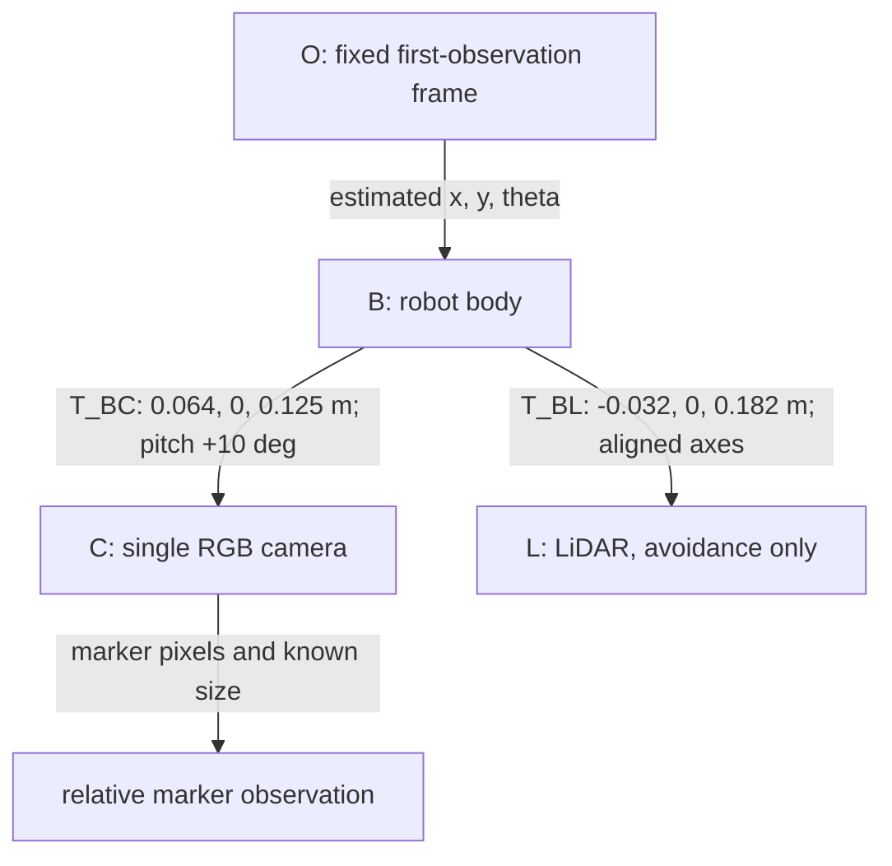
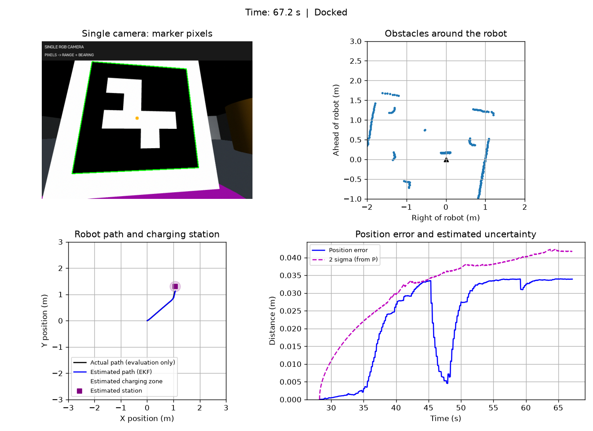

# Track A — Single-camera TurtleBot3 visual docking

**Group number: 36**  
**Team member: wanjun zhang — Student ID 25202185 (sole member, 100% of team contribution)**  
**Code repository: https://github.com/wanjunzhang-netizen/41014-group36-turtlebot3**  
**Project website (GitHub Pages, pending deployment): https://wanjunzhang-netizen.github.io/41014-group36-turtlebot3/**  
**Demo video (maximum 5 minutes): TODO — add an accessible link**

The independent project website is in `website/`. Publish that directory to the `github_page` branch; keep runnable simulation code on `main`. It includes the model, frame diagram, estimator/controller parameters, saved quantitative results, contribution and an embedded video slot.

- [Step-by-step GitHub and Pages upload guide (中文)](docs/04_GitHub上传与协作.md)
- [Five-minute video recording script and embedding guide (中英)](docs/五分钟视频与网页发布.md)
- Website links/video configuration: `website/config.js`.
- Local preview: `.\.venv\Scripts\python.exe -m http.server 8765 --bind 127.0.0.1 --directory website`, then open `http://127.0.0.1:8765`.

Website evidence is a saved snapshot of `evidence/current_dashboard.png`, `evidence/validation_summary.json` and `calibration/monocular_validation.json`. After new validated results, copy these into `website/static/dashboard.png`, `results.json` and `camera-validation.json` respectively, and update the page's explanatory text before publishing.

Simulation-only project in MuJoCo. A TurtleBot3 navigates a 3×3 m room containing six randomly positioned obstacles and docks at an ArUco-marked charging area. Robot and station poses are randomized. For the repeatable seed 0 demo, one of the six obstacles is an orange box fixed 30% along the straight line from the initial robot position to the station; the other five obstacles and the original start/station are retained. Other seeds use the original random generator. The robot faces the marker and places at least one wheel contact inside a 0.20 m radius disk. Electrical charging and real-hardware operation are not demonstrated.

One RGB camera detects marker pixels; known marker size supplies monocular metric scale. Wheel encoders and camera range/bearing feed a joint EKF. A discrete LQR tracker operates on estimated pose. One 2D LiDAR is used **only for avoidance**. This is not a bearing-only filter or a raw pixel-error controller: pixels are converted to range/bearing and fused before tracking.

## Install and run

Windows, Python **3.11**, and an OpenGL-capable graphics driver. Open a terminal in the repository folder:

```powershell
py -3.11 -m venv .venv
.\.venv\Scripts\python.exe -m pip install -r requirements.txt
.\.venv\Scripts\python.exe main.py --seed 0
```

After selecting `.venv\Scripts\python.exe` in VS Code and activating that environment, the one-command demo is `python main.py --seed 0`. Do not copy virtual environments between computers. No ROS installation or remote asset download at runtime is required; model assets are included.

```powershell
python main.py                         # new random layout
python main.py --seed 0                # repeatable baseline
python main.py --seed 0 --camera-dropout 4
python main.py --seed 0 --lidar-sigma 0.012
```

Click the dashboard, then Space/P to pause/resume. Close the viewer normally to save CSV, JSON and PNG in `outputs/monocular/`; identical arguments overwrite their result files. Camera dropout starts five seconds after first landmark initialization. `--headless` suppresses windows but still renders images and requires OpenGL. Failure returns nonzero in headless mode.

```powershell
python -m unittest tests.check_walls tests.check_alignment tests.check_camera tests.check_discovery tests.check_assignment_alignment
python tools/analyze_model.py
python tools/validate_camera_calibration.py
python tools/validate_discovery.py
```

Installation/runtime validation status is in [current results](docs/验证结果.md), distinguishing fresh-install checks from existing-environment tests.

## Model and frames

Body axes: x forward, y left, z up. Optical axes: x right, y down, z forward. Navigation frame O is fixed at the first accepted camera observation; navigation receives no global robot/station coordinates.



Differential-drive state p=[x,y,theta]: xdot=v cos(theta), ydot=v sin(theta), theta_dot=omega. Wheel radius a=0.033 m, track b=0.16 m. Encoder increments give ds=a(dphi_L+dphi_R)/2 and dtheta=a(dphi_R−dphi_L)/b. The discrete model uses the exact constant-turn arc with a stable zero-turn limit. Wheel-rate commands are (v−b omega/2)/a and (v+b omega/2)/a.

The linearized platform has controllability rank 3 at nonzero straight speed, rank 2 at rest. The two-state LQR segment model is controllable. Joint relative measurements have instantaneous rank 2 and global translation/rotation ambiguity; fixing the first-observation frame sets the reference convention, not absolute-world observability. See `tools/analyze_model.py` and [full design](docs/单相机设计与答辩.md).

## Calibration and estimator

The camera detects four ArUco corners (DICT_4X4_50, ID 7, black-square side 0.18 m). Iterative OpenCV PnP uses the pixels, K and known object size to estimate marker pose. Fixed extrinsics convert this to body coordinates: r=sqrt(x_B²+y_B²), beta=atan2(y_B,x_B). Negative depth, reprojection RMS >1.5 px, implausible height/range, non-upright or grazing views are rejected. Known simulation intrinsics/extrinsics are checked with rendered fixtures, not hardware calibration. [Parameters](calibration/monocular.json), [validation](calibration/monocular_validation.json).

Joint EKF state X=[x,y,theta,lx,ly]. Encoders predict; camera h(X)=[sqrt(dx²+dy²), atan2(dy,dx)−theta] corrects, with dx=lx−x, dy=ly−y. The filter propagates full robot/landmark cross-covariance, wraps angles, uses Joseph updates, and rejects NIS>16. During visual loss, it only predicts. Marker normal is smoothed separately and is not included in the five-state covariance.

|Parameter|Value|
|---|---|
|Image/intrinsics|640×480; FOVy=100°; fx=fy≈201.384 px; cx=319.5, cy=239.5; zero distortion|
|Physics / control / camera / LiDAR|0.002 s / 20 Hz / 5 Hz / 10 Hz|
|Encoder noise|scale errors +0.001/−0.001; increment std 0.0015 sqrt(dt/0.05) rad|
|Pixel noise|Gaussian std 1.5 intensity levels|
|LiDAR noise/dropout|std 0.006 m / 1%; 360 rays; max range 6 m|
|Additional EKF Q|diag[0.004²dt+(0.03 abs(ds))², rad(1.5)²dt+(0.08 abs(dtheta))²], added to encoder-derived increment covariance|
|Camera R|diag[(0.008+0.012r²)², rad(1)²]|
|Uncertainty display|2 sqrt(Pxx+Pyy), metres; not an exact 2D 95% confidence boundary|

LiDAR scale/offset calibration uses known wall fixtures and `calibration/lidar.json`. Its retained holdout result does not improve on raw readings (both about 0.0108 m RMSE). LiDAR is not used for EKF localization. Q/R are design assumptions, not a demonstrated statistical consistency guarantee.

## Controller

Mission: explore safely → find marker → approach → align → dock. LiDAR selects safe local waypoints; the tracker computes errors from estimated pose. Before visual initialization, encoder-integrated pose guides exploration. Exploration rejects headings toward a directly visible nearby continuous wall (scan-only line evidence); it permits tangential travel and does not impose this exploration preference on visual docking.

LQR e=[lateral error,heading error], nominal speed 0.08 m/s, dt=0.05 s; Ad=[[1,0.004],[0,1]], Bd=[[0.0001],[0.05]], Q=diag[100,32.8281], R=11.1111. K≈[2.8642,1.7752], omega=−Ke, clipped to ±0.6 rad/s. These cost weights differ from EKF Q/R. Slowing down and state-machine alignment are task adaptations, not a global stability guarantee.

Alignment uses hysteresis: enter within 0.05 m of staging, return to approach only beyond 0.12 m; reacquire stale vision before final entry. This prevents opposing approach/alignment commands from chattering.

Final speed ≤0.025 m/s and turn rate ≤0.3 rad/s. Estimated target distance <0.012 m, estimated wheel in disk with margin, heading error <5°, fresh vision (<0.6 s), held 2 s trigger completion. Independent evaluation requires no collision, real wheel contact within radius 0.20 m, true target error <0.04 m and true heading error <8°. Random generation checks connectivity; reactive planning has no completeness guarantee.

## Ground-truth separation

- `src/discovery/navigation.py` receives estimates, scan data and observation age; no MuJoCo data or map metadata.
- `src/discovery/association.py` receives RGB pixels, not true station pose.
- Physics/rendering/ray casting use internal simulation state to synthesize sensor readings. It is not supplied as a localization observation.
- `src/discovery/app.py` records actual pose only for evaluation curves. Contacts record collision evaluation, not steering. `Trial.save` checks real wheel contacts and goal errors.
- Black=true path (evaluation only), blue=EKF path. Position error and covariance-derived uncertainty are displayed alongside them.

## Results, video and individual contributions

See [quantitative results](docs/验证结果.md) and [batch JSON](evidence/validation_summary.json). Failures are retained. Development-seed success does not imply all random rooms succeed.



**Video: TODO.** Include a complete baseline, at least one varied/disturbed trial, estimate/uncertainty/true-state display, and contributions. Maximum 5 minutes. A 4:50 script is in [the demonstration guide](docs/单相机设计与答辩.md). Mark edits or speed-up. This page is not submission-ready until the group/member/repository/video fields are filled.

**Individual contribution statements:** [CONTRIBUTIONS.md](CONTRIBUTIONS.md). Record actual work per member and real commit/PR evidence. AI assistance is disclosed; no invented reviews or hardware results.

## Layout and provenance

`main.py` starts the demo. `src/perception/`: sensors/calibration; `src/estimation/`: motion; `src/control/`: LQR/avoidance; `src/discovery/`: EKF/mission/UI; `src/simulation/`: physics. `models/` includes licensed TurtleBot3 assets. `calibration/`, `tests/`, `tools/`, `evidence/`, `docs/` provide verification and explanations. Virtual environments, outputs and secrets are ignored.

Motion, Joseph EKF and LQR are adapted from Assessment 3. Monocular PnP, unknown landmark initialization, scene generation and docking are project extensions. Assessment 2 ICP/SIFT odometry is not used. [Sources/licenses](THIRD_PARTY.md). [Chinese upload guide](docs/04_GitHub上传与协作.md).
