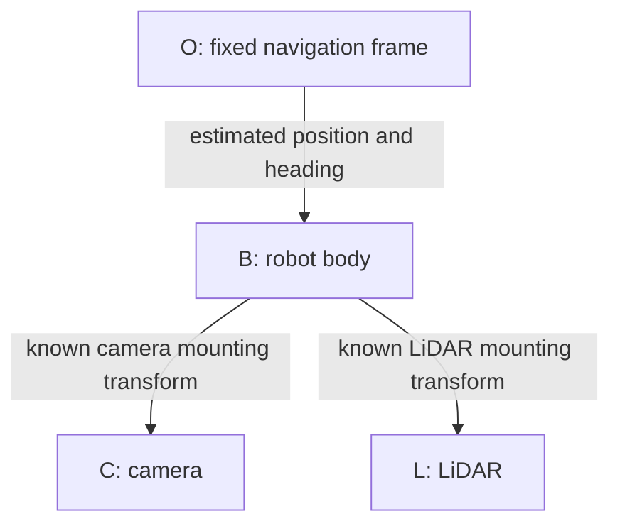

# Project design

## Task

A TurtleBot3 drives in a 3 by 3 metre room with six obstacles. It finds an ArUco marker, avoids obstacles and stops facing the marker. At least one wheel must enter the purple charging circle. The circle has a radius of 0.20 m. This is a simulation of docking, not electrical charging.

The robot and station positions change with the random seed. Seed 0 is a repeatable demonstration: an orange box is placed 30% of the way from the start to the station. The other five obstacles remain. The robot can drive forward or turn in place; it does not drive backwards.

## Where the code is

|File or folder|What it does|
|---|---|
|main.py|Starts the program.|
|src/discovery/scene.py|Creates the room, obstacles, start and station.|
|models/02_robot.xml|Defines the robot and sensor mounting positions.|
|src/perception/|Simulates camera, LiDAR and other sensor readings.|
|src/discovery/association.py|Finds marker corners in the camera image and measures the marker.|
|src/estimation/ekf.py|Contains the robot motion model.|
|src/discovery/estimator.py|Combines wheel motion and camera measurements in the joint EKF.|
|src/control/lqr.py|Corrects path tracking errors.|
|src/control/avoidance.py|Checks safe paths using LiDAR.|
|src/discovery/navigation.py|Chooses search, approach, alignment and docking actions.|
|src/discovery/app.py|Runs the simulation, shows plots and saves results.|
|tests/ and tools/|Check the model, sensors and complete task.|

## Coordinate frames

A frame is a set of axes used to describe a position.



- O starts at the robot when the first valid marker measurement is accepted. That pose is defined as (0, 0, 0). These axes stay fixed afterwards.
- B moves with the robot: x is forward, y is left and z is up.
- C uses optical axes: x is right, y is down and z is forward.
- L has the same axis directions as B. It is used only for obstacle avoidance.

The camera position in B is (0.064, 0, 0.125) m with an upward pitch of 10 degrees. The LiDAR position is (-0.032, 0, 0.182) m. Camera points are converted with `p_B = R_BC p_C + t_BC`. The rotation changes axis directions and the translation accounts for the mounting position. These are known simulation settings, not measured hardware calibration.

## One camera measures distance and direction

The camera finds the four corners of ArUco ID 7 in DICT_4X4_50. The black square is 0.18 m wide. OpenCV PnP uses the corners, camera settings and known size to estimate the marker pose. A pixel direction alone cannot give distance; the known size provides the scale.

The image is 640 by 480 pixels. Vertical field of view is 100 degrees. fx and fy are about 201.384 pixels; cx=319.5 and cy=239.5. Distortion is zero. Rendered test views check these settings. Calibration files are in calibration/.

After conversion to B, horizontal range is `sqrt(x_B^2+y_B^2)` and bearing is `atan2(y_B,x_B)`. Bad measurements are rejected, including reprojection RMS above 1.5 pixels, negative depth, implausible range/height and poor marker views. LiDAR does not measure the station for the EKF.

## Motion model

The robot state is position x, position y and heading theta. Linear speed is v and turn speed is omega.

```text
x_dot = v cos(theta)
y_dot = v sin(theta)
theta_dot = omega
ds = a (delta_phi_left + delta_phi_right) / 2
dtheta = a (delta_phi_right - delta_phi_left) / b
```

Wheel radius a=0.033 m and wheel separation b=0.16 m. Wheel increments predict motion along a constant-turn arc. The zero-turn case is handled without division by zero. Wheel commands are `(v-b*omega/2)/a` and `(v+b*omega/2)/a`.

The linearized robot model has controllability rank 3 when moving straight at nonzero speed, and rank 2 at rest. The latter does not mean the robot cannot move around by turning and driving. A single unknown landmark does not give absolute world coordinates: a common translation or rotation cannot be observed. The instantaneous joint measurement rank is 2. Choosing O fixes the reference, not this physical ambiguity. See tools/analyze_model.py.

## EKF: predict, then correct

The EKF keeps `[x, y, theta, landmark_x, landmark_y]`. Wheel readings predict where the robot moved. Camera range and bearing correct that prediction. When the camera loses the marker, wheel prediction continues without a camera correction.

```text
P_prediction = A P A_transpose + B Q B_transpose
range = sqrt((landmark_x-x)^2 + (landmark_y-y)^2)
bearing = atan2(landmark_y-y, landmark_x-x) - theta
```

P stores estimated uncertainty and relationships between errors. A and B describe how motion carries errors forward. Q describes uncertainty in motion; R describes uncertainty in camera measurements. They do not add a second random disturbance to the robot. The update uses Joseph form, wraps angles, keeps robot/landmark cross-covariance and rejects NIS above 16. Marker facing direction is smoothed separately and is not part of the five-state P.

|Setting|Value|
|---|---|
|Extra motion Q, added to encoder-derived covariance|diag[0.004^2 dt + (0.03 abs(ds))^2, rad(1.5)^2 dt + (0.08 abs(dtheta))^2]|
|Camera R|diag[(0.008 + 0.012 range^2)^2, rad(1)^2]|
|Simulated wheel scale errors|+0.001 and -0.001|
|Wheel increment noise standard deviation|0.0015 sqrt(dt/0.05) rad|
|RGB pixel noise standard deviation|1.5 pixel intensity units|
|LiDAR noise standard deviation / dropout|0.006 m / 1%|
|Camera / LiDAR / control rate|5 / 10 / 20 Hz|
|Physics step|0.002 s|

Q and R are design settings; no statistical consistency calibration is claimed.

## Tracking and avoidance

LiDAR selects short safe waypoints. The LQR tracker uses estimated lateral and heading errors to steer toward them. Before the first marker observation, exploration uses wheel odometry. After initialization, tracking uses the EKF estimate.

LQR design values: speed=0.08 m/s, dt=0.05 s, A=[[1,0.004],[0,1]], B=[[0.0001],[0.05]], Q=diag[100,32.8281], R=11.1111 and K approximately [2.8642,1.7752]. The turn command is `omega=-K*[lateral_error,heading_error]`. LQR Q and R are costs for errors and control effort, not EKF noise values. Turn speed is limited to 0.6 rad/s.

During search, LiDAR rejects directions toward a nearby continuous wall. Within 25 degrees of the candidate direction, at least 90% of readings must be valid, adjacent points must be within 0.18 m, and the fitted line must span at least 0.65 m. RMS error must be at most 0.025 m and maximum error at most 0.065 m. A wall within 1.20 m blocks the direction if the direction/normal dot product exceeds 0.70. This rule applies only to exploration. It is a simple geometric rule, not a perfect wall classifier. Normal clearance checks still apply.

The stages are search, approach, align and final docking. The robot enters alignment within 0.05 m of its staging target and returns to approach only beyond 0.12 m. These separate thresholds prevent repeated left-right switching. If vision is older than 0.6 s, it stops moving forward and turns toward the estimated marker to find it again.

Final speed is at most 0.025 m/s and turn speed at most 0.3 rad/s. Completion requires estimated target error below 0.012 m, estimated wheel entry, heading error below 5 degrees, recent vision and a 2-second hold. A separate evaluation checks true wheel contact and errors. There is no guarantee of reaching the goal in every possible room.

## Ground truth and the four plots

The simulator uses its internal state to generate sensors. The controller does not receive true robot or station coordinates. Navigator.command receives estimates and sensor data. True pose and collision information are used separately to score the trial and draw evaluation plots.

|Plot|Plain explanation|
|---|---|
|Camera|The image used to find the marker corners.|
|LiDAR|Horizontal is metres to the robot's right; vertical is metres ahead. Points are nearby surfaces.|
|Path|Both axes are position in metres in O. Blue is the EKF path. Black is the true path, for evaluation only.|
|Error and uncertainty|Horizontal is time in seconds; vertical is metres. Blue is actual position error. Purple is 2 sqrt(Pxx+Pyy).|

The purple line describes estimated uncertainty. It is not an exact two-dimensional 95% confidence bound. Blue staying below purple is not enough to prove a statistically consistent filter.

## Course basis and extensions

Assessment 3 informed exact-arc motion, the Joseph EKF update and LQR tracking. Marker PnP, joint landmark initialization, scene generation and docking logic are project extensions. Assessment 2 ICP/SIFT is not used. Third-party sources and asset licenses are listed in THIRD_PARTY.md.
