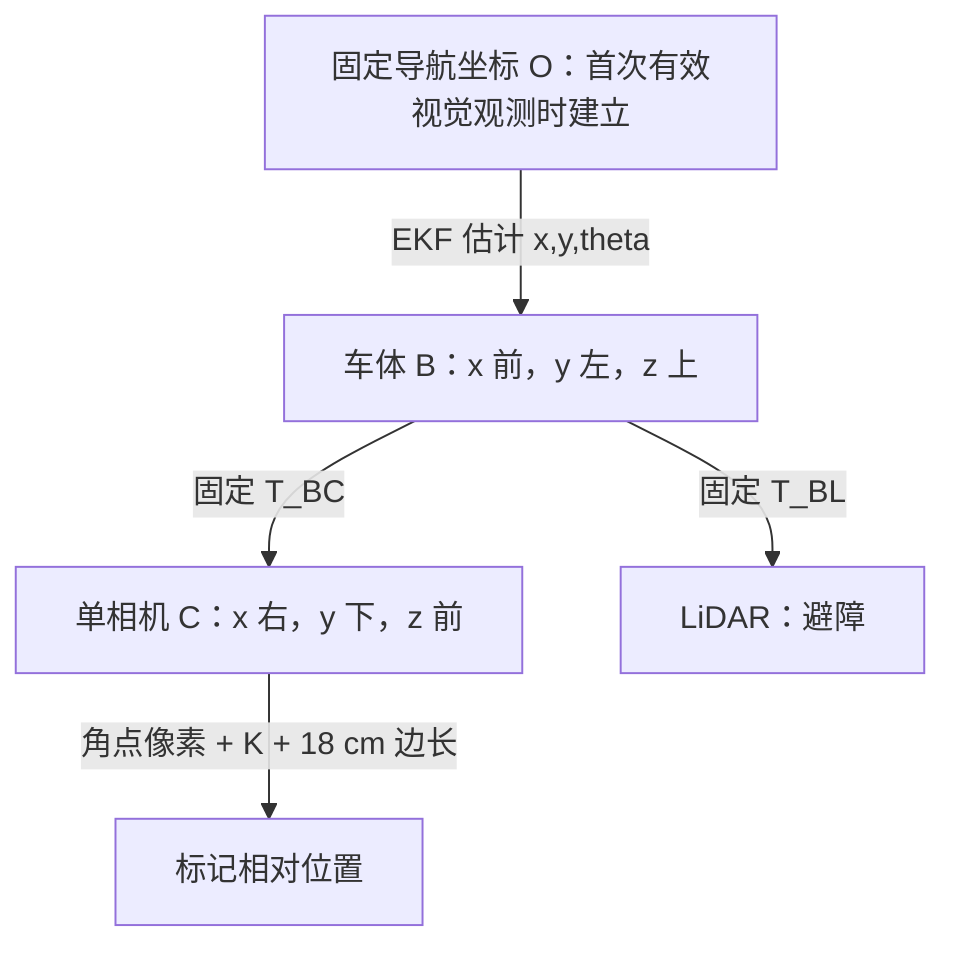

# 单相机版本：设计、参数与答辩

本文件描述当前单相机版本。地图仍为 3×3 m、六个随机障碍、小车和充电站随机位置与朝向。充电区是以标记地面投影为圆心、半径 0.20 m 的圆盘。小车只前进或原地转向，最后正面标记、至少一个车轮接地点进入圆盘。不是模拟电气充电。

## 1. 一个相机怎样根据像素导航

保留中层 `front_camera`，移除顶层相机和支架。检测 ArUco ID 7 的四个像素角点，已知黑色标记边长 0.18 m，使用 OpenCV `solvePnP` 计算标记相对于相机的位置及朝向。通过固定外参转换到车体坐标，再计算水平距离 r 和方位 β。

像素中心表示图像中的方向，但单个像素不能提供距离。已知标记尺寸提供单目测距的尺度。这是单相机像素测量，经 EKF 进入导航；不是直接用图像横向偏差替代全部 LQR 控制，也不是从雷达读取充电站距离。PnP 是本项目的工程扩展，不能声称是作业 2/3 原样代码。

代码：`src/discovery/association.py` 的 `marker_corners`、`pose_from_pixels`、`observe`。仅输入 RGB 数组，不接收仿真位姿或场景地图。

相机参数位于 `src/perception/camera.py`，实际安装位于 `models/02_robot.xml`：640×480，垂直视场 100°，fx=fy≈201.384 px，cx=319.5，cy=239.5，畸变为零。相机在车体中的位置为 (0.064, 0, 0.125) m，向上倾斜 10°。固定参数来自已知仿真模型，`tools/validate_camera_calibration.py` 检验外参和渲染测量误差；不是实物棋盘格标定。

## 2. 坐标系

变换：p_B = R_BC p_C + t_BC。r=sqrt(x_B²+y_B²)，β=atan2(y_B,x_B)。首次有效观测将当时车体位置和航向定义为 (0,0,0)，不是读取真实世界坐标用于定位。O 此后固定，不随车移动。LiDAR 在 B 中的位置为 (-0.032,0,0.182) m，轴向相同；它只把扫描点转换到车体坐标用于碰撞余量检查，不参与 EKF。

## 3. 状态空间模型与 EKF

差速车模型：xdot=v cosθ，ydot=v sinθ，θdot=ω。轮半径 a=0.033 m，轮距 b=0.16 m；ds=a(ΔφL+ΔφR)/2，dθ=a(ΔφR−ΔφL)/b。离散模型使用恒定转率精确圆弧，零转角处使用稳定极限，见 `src/estimation/ekf.py`。

联合 EKF 状态为 [x,y,θ,lx,ly]，同时估计车体和初次发现的标记位置。编码器负责预测，相机 z=[r,β] 负责修正。观测模型：r=sqrt((lx−x)²+(ly−y)²)，β=atan2(ly−y,lx−x)−θ。

P预测=A P Aᵀ+B Q Bᵀ；更新采用 Joseph 形式并对称化。NIS 大于 16 的观测被拒绝。没有图像时只进行编码器预测。代码在 `src/discovery/estimator.py`。标记法向另作平滑，用于停车朝向，不包含在五维 P 中。

过程噪声 Q：编码器增量方差经运动学映射，加 diag[0.004²dt+(0.03|ds|)², rad(1.5)²dt+(0.08|dθ|)²]。相机 R=diag[(0.008+0.012r²)², rad(1)²]。这些是滤波器设计不确定性，不是又注入一次随机噪声，也未声称经过统计一致性标定。

实际模拟噪声：编码器左右比例偏差 +0.001/−0.001，增量角噪声标准差 0.0015 sqrt(dt/0.05) rad；RGB 像素独立高斯标准差 1.5；LiDAR 距离标准差 0.006 m，丢失率 1%。相机 5 Hz，雷达 10 Hz，控制 20 Hz，物理步长 0.002 s。

可控性：直行非零速度处三维车体线性化可控秩为 3，静止处为 2；后者不代表差速车不能通过转向和前进移动。联合相对观测 H 的瞬时秩为 2，共同平移/旋转不可观，首次观测固定参考系。不能宣称单个未知标记提供绝对世界定位。`tools/analyze_model.py` 输出这些检查。

## 4. 控制器和避障

`src/control/lqr.py` 使用作业 3 改编的直线段误差模型 e=[横向误差,航向误差]。设计速度 0.08 m/s、dt=0.05 s，Ad=[[1,0.004],[0,1]]，Bd=[[0.0001],[0.05]]，Q_LQR=diag[100,32.8281]，R_LQR=11.1111，K≈[2.8642,1.7752]。ω=−Ke，限制 ±0.6 rad/s。此 Q/R 是控制代价，与 EKF 噪声协方差不同。

LiDAR 提供安全短航点，LQR 通过 EKF 位姿追踪航点。初次看到标记之前，使用编码器积分估计执行探索。导航状态为搜索→接近→对正→最后停靠。最终速度不超过 0.025 m/s、转率 ±0.3 rad/s，距估计停车目标 <0.012 m、估计轮点进区、朝向误差 <5°、视觉观测年龄 <0.6 s 后保持 2 s。控制器只能依据估计条件宣布完成；独立评价再检查真实成功。

真实成功检查：完成、无碰撞、至少一个真实轮子地面接触点在 0.20 m 圆盘内、真实停车目标误差 <0.04 m、真实朝向误差 <8°。没有无障碍路径完备性保证。

## 5. 真值隔离

物理引擎必须使用物理状态生成图像、扫描和编码器，这是模拟传感器的内部机制。`Navigator.command` 的输入是估计器、编码器搜索估计、扫描和观测年龄，不接收场景真实坐标。`Trial.step` 中真值转换只用于记录曲线；接触检测只记录碰撞评价，不驱动导航。`Trial.save` 用真值计算误差和最终达标情况。不能将真实位姿作为 EKF 观测或控制器输入。

## 6. 四幅图怎么讲

|图|中文|English|
|---|---|---|
|单相机图像|绿色框是检测到的标记，橙点是四个角点的平均像素位置。已知标记大小让我们从像素估计距离和方向。|The camera detects the marker corners. Its known size lets us estimate distance and direction from pixels.|
|雷达点图|横轴向车的右侧，纵轴向车前方，单位都是米。点表示周围物体，雷达只用于避障。|The axes show metres to the robot's right and ahead. LiDAR is used only for obstacle avoidance.|
|轨迹图|横纵轴是首次看到标记时建立的固定坐标，单位米。蓝线是 EKF 估计，黑线是真实轨迹，仅用于评价。|Blue is the estimated path. Black is the true path for evaluation only. The fixed frame starts at the first valid visual observation.|
|误差与不确定性|横轴时间秒，纵轴米。蓝线是真实位置误差，紫线是从 P 算出的 2 sqrt(Pxx+Pyy)，表示估计不确定性。|Blue shows the actual position error. Purple shows estimated uncertainty from the filter covariance.|

紫线不是严格的二维 95% 置信边界，蓝线低于紫线也不能单独证明滤波器统计一致。

## 7. 五分钟视频安排（总长 4:50）

先分别运行 seed 0 基线和 seed 0 相机失效对照，保存日志。录制 MuJoCo 和完整四幅图；如剪辑或加速必须标注，不能将两次实验拼成一次成功。

|时间|展示和台词|
|---|---|
|0:00–0:20|组号、姓名、Track A、仅仿真。"This is Track A: visual docking in MuJoCo, using one camera and one LiDAR."|
|0:20–0:45|模型与坐标图。"Wheel encoders predict motion. Camera pixels provide marker range and bearing. The EKF combines them."|
|0:45–2:25|基线任务完整流程；确保可见实际停车。"The controller uses the estimated pose. LiDAR selects safe directions around obstacles."|
|2:25–4:15|同 seed 相机暂时失效试验；包含失效、恢复、最终完成。"The camera is deliberately disabled for four simulated seconds. The filter predicts with encoders, then corrects when vision returns."|
|4:15–4:40|量化表和曲线。"Black is ground truth for evaluation only. The uncertainty is calculated from the EKF covariance."|
|4:40–4:50|个人实际贡献、仓库链接。不要宣称未做的硬件测试或人工代码审查。|

视频尚需学生录制、上传并在 README 填入可访问链接。必须在提交前以未登录/老师可访问方式确认播放权限。

## 对正阶段防抖修复（2026-11-02）

此前接近点距离在 5 cm 边界附近波动，会反复切换 APPROACH 和 ALIGN，导致相反的转向指令。现采用阶段保持与双门槛：距离 <5 cm 进入 ALIGN，只在偏离 >12 cm 时退回 APPROACH；相机观测超过 0.6 s 未更新时，先停止前进并转向估计标记位置，重新识别后继续对正。仍使用估计位姿，未改变圆盘尺寸或成功判定。

CSV 新增 navigation_phase、vision_age_s、staging_distance_m 便于定位切换问题。回归测试见 tests/check_alignment.py。

## 探索时不朝已看清的近处墙面移动

`src/control/avoidance.py` 的 `heads_into_visible_wall` 只用雷达数据判断连续墙面，`Navigator.search` 在选择和继续已有探索航点时都检查。候选方向左右各25°内，需要至少90%有效回波、相邻点间距不超过0.18 m、拟合直线长度至少0.65 m、均方根残差不超过0.025 m且最大残差不超过0.065 m。墙法向距离小于1.20 m、行进方向与朝墙法向点积超过0.70时，拒绝该探索方向。

短障碍物、遮挡造成的不连续回波不能直接当成连续长墙；沿墙方向和远处墙不被此规则禁止。封闭房间各方向最终都有墙，因此不能禁止所有远处有墙的方向。无可靠墙面证据不等于安全，原来的雷达路径间距检查仍必须通过。找到充电站后的目标接近、对正、停靠不应用这一探索偏好，保留原有避障。

这是有阈值的雷达几何启发式，不是相机语义识别，不能保证所有遮挡情况都被准确分类。没有读取墙体真实坐标。
